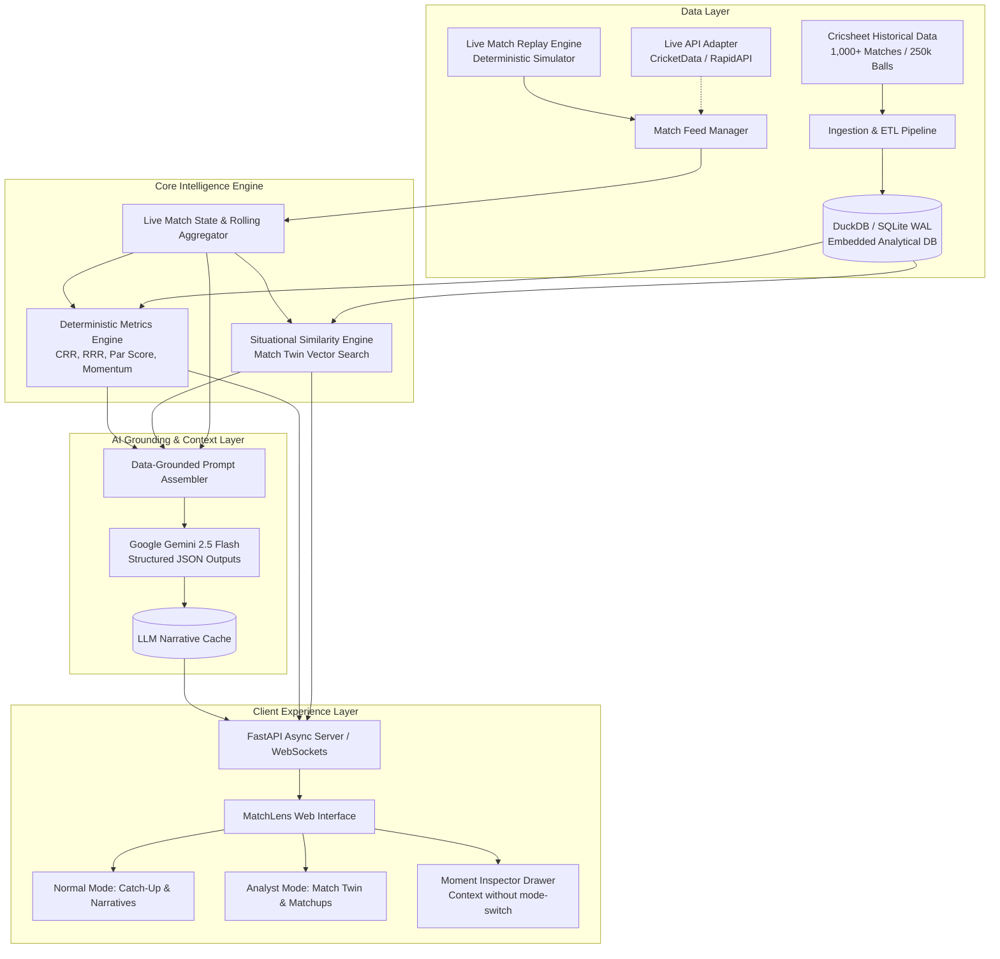
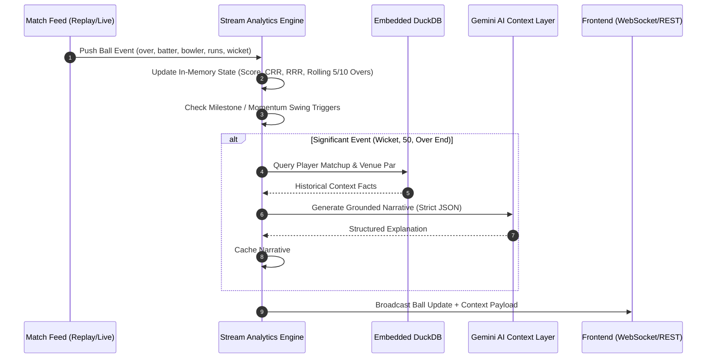

# MatchLens: Architecture & Practical Implementation Plan
**AI-Powered Live Sports Context Companion (IPL Cricket)**

---

## Executive Summary & Product Architecture

MatchLens transforms the passive, numbers-heavy live scorecard into an intelligent, contextual storytelling companion. Rather than forcing fans to decipher raw statistics or cognitive overload, MatchLens computes deterministic match intelligence and pairs it with focused, hallucination-free generative AI to explain *why* the match is unfolding the way it is.



---

## 1. Cricket Data Sources: Availability, Pricing & Licensing

For a five-day internship prototype, relying strictly on commercial live cricket APIs introduces high costs, credit card locks, fragile rate-limits, and an inability to demo when no live IPL match is actively being broadcast. 

### Data Source Matrix

| Source | Coverage | Format | Pricing | License / Terms | Practical Assessment for 5-Day Sprint |
| :--- | :--- | :--- | :--- | :--- | :--- |
| **Cricsheet.org** *(Primary Historical)* | All IPL matches (2008–2024/2025), ball-by-ball | JSON (v1.3.0), CSV, YAML | **100% Free** | Open Data (ODC-BY / CC BY 4.0) | **Essential Foundation**: Complete, authoritative, structured data for all historical comparisons, player statistics, and venue averages. |
| **Deterministic Live Replay Engine** *(Primary Live)* | Any Cricsheet IPL match streamed ball-by-ball | In-memory event stream over WebSocket/SSE | **Free** | Internal software component | **Mission-Critical**: Enables deterministic testing and demos at any hour of the day. Evaluators can scrub, speed up, or simulate clutch situations (e.g. 2023 CSK vs GT Final). |
| **CricketData.org (CricAPI)** *(Secondary Live)* | Live international & league scores | REST JSON | Free tier: 100 hits/day. Paid: $5.99/mo (2k hits/day) | Proprietary developer API | **Optional Fallback**: Good for testing real-time ingestion, but 100 hits/day exhausts in ~15 minutes of live ball polling. |
| **RapidAPI (Cricbuzz / Cricket Live Data)** | Live ball-by-ball commentary & scores | REST JSON | Free tier: 20–100 calls/month | Proprietary scraping wrappers | **Fragile**: High risk of breaking during review; strict rate-limit penalties. |
| **Sportmonks Cricket API** | Ball-by-ball, player stats, wagon wheels | REST JSON | 14-day trial (requires credit card), then €29/mo | Commercial | Not recommended for 5-day internship due to credit card overhead. |

### Strategic Recommendation: Hybrid Feed Architecture
1. **Primary Feed**: A built-in **Live Match Replay Engine** that plays back real Cricsheet ball-by-ball data at configurable speeds (1x, 2x, 5x, or manual ball-stepping).
2. **Pluggable Interface (`MatchFeedAdapter`)**: An abstract class with two implementations: `ReplayMatchFeed` and `ExternalLiveMatchFeed`. Switching between simulated match events and a live API is a single environment variable change (`FEED_MODE=replay|live`).

---

## 2. Data Collection, Processing, and Storage Pipeline



### 2.1 Collection & Stream Normalization
Every incoming delivery is normalized into a strict `BallDelivery` schema:
- `match_id`, `innings` (1 or 2), `over` (0–19), `ball` (1–6+ extras)
- `batter`, `bowler`, `non_striker`
- `runs_batter`, `runs_extras`, `extra_type` (`wide`, `noball`, `bye`, `legbye`, `penalty`)
- `wicket`: `{ is_wicket: bool, player_out: str, kind: str, fielders: list[str] }`
- `context`: `cumulative_runs`, `cumulative_wickets`, `balls_remaining`, `target_runs`

### 2.2 Processing & Deterministic Metric Calculations
All objective cricket statistics are computed in real time by the deterministic engine:
1. **Current Run Rate (CRR)**: $\frac{\text{Runs}}{\text{Legal Overs Completed}}$
2. **Required Run Rate (RRR)**: $\frac{\text{Runs Needed} \times 6}{\text{Balls Remaining}}$
3. **Rolling Window Aggregates**:
   - Previous 5 overs (last 30 legal balls) score & wickets.
   - Previous 10 overs (last 60 legal balls) score & wickets.
   - Phase breakdown: Powerplay (overs 1–6), Middle (7–15), Death (16–20).
4. **Momentum Shift Index**:
   - Computed by comparing the actual runs scored in an over against the venue historical par for that specific over and wickets lost.
   - Threshold triggers: An over with $\ge 15$ runs, a multi-wicket over, or a maiden over flags an automatic "Momentum Pivot".

### 2.3 Storage Architecture
- **Analytical Storage (Historical)**: **DuckDB** (or SQLite in WAL mode).
  - *Why DuckDB?* It reads Cricsheet JSON/Parquet files directly, requires zero standalone server/docker infrastructure, and runs aggregate analytical queries over 250,000 deliveries in **< 15 milliseconds**.
  - Tables: `dim_matches`, `dim_players`, `dim_venues`, `fact_deliveries`, `agg_head_to_head`.
- **Live State Cache**: In-process Python dictionary/dataclass with periodic snapshots. Zero external Redis setup needed for a single-server internship prototype.

---

## 3. Historical Match Situational Comparison Engine ("Match Twin")

hardcore fans often ask: *"Has a team ever chased 60 off 30 balls at Wankhede with 6 wickets down?"*
MatchLens answers this deterministically using multi-dimensional situational vector matching.

### 3.1 Situational Signature Vector
At any moment in the 2nd innings (or death overs of the 1st innings), the engine constructs a match state vector:

$$S = \begin{bmatrix}
\text{balls\_remaining} \\
\text{wickets\_lost} \\
\text{runs\_needed} \\
\text{required\_run\_rate} \\
\text{venue\_pace\_factor}
\end{bmatrix}$$

### 3.2 Nearest-Neighbor Situational Search
Instead of slow or ungrounded vector embeddings, we execute a deterministic, indexed similarity search against the 1,000+ historical IPL matches:

```sql
SELECT 
    match_id,
    match_date,
    team1, team2,
    winner,
    target_runs,
    runs_at_checkpoint,
    wickets_at_checkpoint,
    balls_remaining,
    ABS(balls_remaining - :current_balls_left) AS delta_balls,
    ABS(wickets_at_checkpoint - :current_wickets_lost) AS delta_wickets,
    ABS(rrr_at_checkpoint - :current_rrr) AS delta_rrr,
    (
        0.35 * ABS(balls_remaining - :current_balls_left) +
        0.35 * ABS(wickets_at_checkpoint - :current_wickets_lost) * 6 +
        0.30 * ABS(rrr_at_checkpoint - :current_rrr) * 4
    ) AS similarity_penalty
FROM historical_chase_checkpoints
WHERE balls_remaining BETWEEN :current_balls_left - 6 AND :current_balls_left + 6
  AND wickets_at_checkpoint BETWEEN :current_wickets_lost - 1 AND :current_wickets_lost + 1
ORDER BY similarity_penalty ASC
LIMIT 3;
```

### 3.3 Output of the Match Twin Engine
The engine returns:
1. **Win Probability Distribution**: *"In the 18 historical IPL instances matching this exact situation, the chasing team won 33% of the time (6 wins, 12 losses)."*
2. **Top 3 Closest Historical Matches**: Exact match cards showing year, teams, what happened, and final margin.
3. **Clutch Incident Citation**: *"Most similar precedent: MI vs KKR (2017) — 60 needed off 30, Hardik Pandya scored 29*(11) to seal the chase with 1 ball remaining."*

---

## 4. Recommended System Architecture & Technology Stack

To ensure rapid execution within 5 days without compromising engineering quality:

```
┌─────────────────────────────────────────────────────────────┐
│                      Frontend (Browser)                      │
│   React 18 + Vite + Vanilla Modern CSS (Dark Sports Theme)  │
│   • Over Scrubber & Timeline    • Live Score Strip          │
│   • Normal Mode View Component  • Analyst Mode View Comp    │
│   • Moment Inspector Drawer (Inline Exploration)            │
└──────────────────────────────▲──────────────────────────────┘
                               │ HTTP / WebSocket (SSE)
┌──────────────────────────────▼──────────────────────────────┐
│                    FastAPI Backend (Python)                  │
│   • /api/matches/{id}/live          (WebSocket / Polling)   │
│   • /api/matches/{id}/catchup       (Normal Mode Narrative) │
│   • /api/matches/{id}/match-twin    (Analyst Mode Search)   │
│   • /api/matches/{id}/moment/{ball} (Moment Context Expl)   │
│   • /api/simulation/controls        (Play/Pause/Scrub)      │
├──────────────────────────────┬──────────────────────────────┤
│ Deterministic Engine         │ AI Grounding Engine          │
│ • Rolling Over Aggregator    │ • Gemini 2.5 Flash SDK       │
│ • Situational Vector Matcher │ • Strict Pydantic JSON Schema│
│ • Head-to-Head Calculator    │ • Contextual Prompt Injector │
├──────────────────────────────┴──────────────────────────────┤
│ Storage Layer                                                │
│ • DuckDB (Embedded, Parquet/Cricsheet JSON Ingestion)        │
│ • In-Memory Active Match Cache                               │
└─────────────────────────────────────────────────────────────┘
```

### Technology Selection Rationale

| Layer | Recommended Choice | Alternatives Considered | Why This Choice Fits the 5-Day Assignment |
| :--- | :--- | :--- | :--- |
| **Backend** | **Python (FastAPI)** | Node.js (Express) | Python is standard for cricket data wrangling (Pandas/DuckDB), native mathematical vector matching, and first-party Google GenAI SDK. FastAPI provides out-of-the-box async WebSocket support and auto Swagger documentation. |
| **Database** | **DuckDB** + SQLite | PostgreSQL + pgvector | Zero infrastructure burden. No Docker daemon dependencies. DuckDB queries 250,000 Cricsheet deliveries in memory in milliseconds. Vector search for tabular match situations is faster via indexed SQL than heavy embeddings. |
| **Frontend** | **React + Vite + Modern CSS** | Next.js / Streamlit | Streamlit is too inflexible for high-fidelity dual-mode UI. React with Vite allows instant HMR, clean component isolation, modern dark sports aesthetic (glassmorphism, vibrant team colors), and seamless WebSockets. |
| **Styling** | **Vanilla CSS + Design Tokens** | TailwindCSS | Adheres to prompt web application guidelines: pristine custom CSS variables, sleek dark mode, micro-animations, avoiding generic boilerplate. |
| **AI Model** | **Google Gemini 2.5 Flash** | GPT-4o / Claude 3.5 | Sub-second latency, structured JSON output mode, cost-effective, native to Google Antigravity environment. |

---

## 5. Where AI Genuinely Adds Value (vs. Deterministic Code)

A core failure mode of "AI sports apps" is using an LLM to count runs or compute averages, resulting in hallucinated statistics. MatchLens enforces strict architectural boundaries:

```
┌─────────────────────────────────┐       ┌──────────────────────────────────┐
│   Deterministic Engine (Code)   │       │      Generative AI (Gemini)      │
├─────────────────────────────────┤       ├──────────────────────────────────┤
│ • Exact runs, wickets, overs    │       │ • Contextual Catch-Up Narrative  │
│ • Current & Required Run Rates  │       │ • "Why This Moment Matters"      │
│ • Rolling 5/10 over stats       │       │ • Situational Pressure Story     │
│ • Head-to-head career records   │ ────> │ • Casual vs Analyst Tone Shift   │
│ • Match Twin similarity query   │       │ • Tactical Subtext Explanation   │
│ • Venue historical par score    │       │   (e.g., pace vs spin rationale) │
└─────────────────────────────────┘       └──────────────────────────────────┘
```

### Specific AI Features:
1. **The "Catch-Up in 30 Seconds" Narrative Generator**:
   - *Input*: Deterministic milestones (Toss, Powerplay score, key dismissals, momentum shifts).
   - *Output*: A punchy 3-bullet story explaining what happened while the user was away.
2. **Momentum Shift Explainer ("Why did the tide turn?")**:
   - *Input*: Over 12 yielded 21 runs; bowler mismatch statistics.
   - *Output*: Explains the tactical calculation: *"MI targeted the 5th bowler quota, knowing Bumrah had 2 death overs saved."*
3. **Dual-Persona Narrative Synthesis**:
   - **Normal Mode**: Lighthearted, emotional, narrative-driven, devoid of obscure cricket jargon.
   - **Analyst Mode**: Focuses on matchups, match phase leverage, execution against lengths, and historical precedent.
4. **Guardrail Strategy (Zero Hallucinations)**:
   - All prompts use strict data injection: `Only use the provided statistics table. Do NOT invent or extrapolate any unlisted numbers.`
   - Pydantic schema validation ensures outputs adhere to structured JSON contracts before rendering.

---

## 6. UI/UX Architecture: Normal Mode vs. Analyst Mode

The user interface balances simplicity for casual viewers with depth for analytical fans, without requiring a complete context shift.

```
┌──────────────────────────────────────────────────────────────────────────────────┐
│  MATCHLENS  [🔴 LIVE] CSK 142/3 (15.2 ov) | CRR: 9.26 | RRR: 11.57 | Target: 196  │
│  Mode: [⚡ Normal (Casual) ] [ 📊 Analyst ]       [ ⚡ 30s Catch-Me-Up ]         │
├──────────────────────────────────────────────────────────────────────────────────┤
│  OVER PROGRESSION STRIP (Interactive Scrubber)                                   │
│  Ov 1-6 [54/1] ── Ov 7-10 [28/1] ── Ov 11-15 [56/1] ── [Ov 16: • 4 1 W 6 •]      │
├────────────────────────────────────────┬─────────────────────────────────────────┤
│              NORMAL MODE               │              ANALYST MODE               │
│                                        │                                         │
│ • Catch-Up Narrative:                  │ • Match Twin Precedents:                │
│   "CSK weathered early swing and       │   "Chasing 54 off 28 at Chepauk:        │
│   accelerated via Gaikwad's 62(38).    │   Chasers win 28% of historical games.  │
│   Current match situation is tense."   │   Top Match: CSK vs KKR (2021)"         │
│                                        │                                         │
│ • 5-Over Scoring Progression:          │ • Tactical Matchup Radar:               │
│   [ Bar chart: 8, 14, 6, 18, 10 ]      │   Dube vs Left-Arm Spin: SR 174, 2 wkts │
│                                        │                                         │
│ • Momentum Shift Highlights:           │ • Leverage Index & Phase Comparison:    │
│   ⚡ Ov 13.4: Gaikwad 6 & 4 off Bishnoi│   Powerplay: +1.2 above venue par       │
│   🚨 Ov 14.1: Bishnoi traps Gaikwad    │   Middle Overs: -0.4 below venue par    │
└────────────────────────────────────────┴─────────────────────────────────────────┘
```

### Key Interaction: The "Moment Inspector" Drawer
- **Problem**: In traditional sports apps, deep analysis requires leaving the live scorecard.
- **Solution**: A user in **Normal Mode** can click *any delivery, wicket icon, or over block* on the timeline scrubber. A slide-out **Moment Inspector Drawer** opens, revealing:
  - Ball video/graphic representation & speed/type.
  - Head-to-head context at that specific moment.
  - AI micro-explanation: *"Why this dot ball was high leverage."*
  - Closing the drawer returns the user seamlessly to their primary view without disrupting their live tracking.

---

## 7. Milestone-Based 5-Day Implementation Roadmap

```mermaid
gantt
    title MatchLens 5-Day Implementation Schedule
    dateFormat  X
    axisFormat Day %d
    
    section Day 1: Foundation & Data
    Cricsheet IPL Ingestion & DuckDB Setup    :active, d1_1, 0, 1
    Deterministic Live Replay Engine         :active, d1_2, 0, 1
    Basic Metrics Engine (CRR, RRR, Rolling) :active, d1_3, 0, 1
    
    section Day 2: Intelligence Engine
    Situational Similarity (Match Twin)      :d2_1, 1, 2
    Head-to-Head & Venue Aggregation Cache   :d2_2, 1, 2
    FastAPI Endpoints & WebSocket Server     :d2_3, 1, 2
    
    section Day 3: AI Context Layer
    Gemini 2.5 Structured Prompt Engineering :d3_1, 2, 3
    Grounding & Anti-Hallucination Pipeline  :d3_2, 2, 3
    Catch-Up & Moment Narrative Generation   :d3_3, 2, 3
    
    section Day 4: UI & Mode Experiences
    Vite + React UI Shell & Live Scrubber    :d4_1, 3, 4
    Normal Mode & Analyst Mode Views         :d4_2, 3, 4
    Moment Inspector Drawer & Transitions    :d4_3, 3, 4
    
    section Day 5: Polish & Validation
    Live Simulation Scenarios (CSK vs GT)    :d5_1, 4, 5
    End-to-End Latency & Edge-Case Testing   :d5_2, 4, 5
    Demo Script & Final Walkthrough          :d5_3, 4, 5
```



### Day 1: Data Architecture & Replay Simulator
- Download & parse Cricsheet IPL historical dataset (curating DuckDB tables for matches, deliveries, and players).
- Build the `ReplayMatchFeed` simulator capable of streaming ball-by-ball events via WebSockets with play/pause/speed controls.
- Implement basic rolling statistics (last 5 overs, last 10 overs, phase totals).
- **Validation**: Verify that computed match scorecards match official Cricsheet outcomes to 100% precision.

### Day 2: Analytics & Match Twin Similarity Engine
- Build the deterministic `MatchTwin` situational search engine (indexed SQL query against historical chase checkpoints).
- Pre-aggregate player vs player head-to-head records and venue par scores.
- Expose REST and WebSocket endpoints in FastAPI (`/live`, `/catchup`, `/match-twin`, `/moments`).
- **Validation**: Test similarity query on iconic games (e.g. 2019 IPL Final, 2023 IPL Final) and verify query execution under 25ms.

### Day 3: AI Grounding & Context Generation Pipeline
- Integrate Google GenAI SDK (Gemini 2.5 Flash) with Pydantic JSON schemas.
- Build prompt templates:
  - `generate_catchup_summary(match_state, milestones)`
  - `explain_moment(ball_event, matchup_stats, momentum_delta)`
  - `generate_analyst_take(situation_vector, match_twins)`
- Implement in-memory narrative cache to prevent redundant API calls.
- **Validation**: Hallucination testing — verify that every player name, run count, and ball referenced in AI output strictly matches injected context.

### Day 4: Modern Web UI (Normal & Analyst Modes)
- Set up React + Vite frontend with vanilla CSS design tokens (dark sports UI, glassmorphic panels, dynamic animations).
- Build the top Live Match Header and interactive Timeline Scrubber.
- Implement **Normal Mode**: Catch-up summary cards, 5-over momentum bars, match narrative.
- Implement **Analyst Mode**: Match Twin historical comparisons, head-to-head radar, phase breakdown.
- Build the **Moment Inspector Drawer** allowing in-depth inspection of any ball without mode switching.
- **Validation**: Responsive layout testing, mode switching responsiveness, timeline scrub smoothness.

### Day 5: Integration, Edge Cases & Evaluation Demo
- End-to-end integration: Live Replay Simulator ➔ FastAPI ➔ Gemini AI ➔ React Client.
- Test edge cases: Match start (0.1 ov), super overs, rapid wicket collapses, target achieved.
- Prepare 3 curated demo scenarios:
  1. *The Late Joiner Scenario*: Opening app at Over 14.3 of a tense chase (evaluating Normal Mode catch-up).
  2. *The Tactician Scenario*: Inspecting Dhoni vs Narine matchup and 16th-over leverage (evaluating Analyst Mode).
  3. *The Moment Scrubber*: Scrubbing back to a controversial run-out in Over 8 (evaluating Moment Inspector).
- Document setup instructions and record walkthrough.

---

## 8. Key Engineering Assumptions & Guardrails

1. **Deterministic Authority**: The AI model is **never** asked to calculate runs, balls, strike rates, or historical outcomes. It is strictly used as an analytical writer and contextual explainer given verified input data.
2. **Deterministic Evaluation**: During project evaluation, external live matches might not be on. The live replay engine ensures that evaluators can see realistic real-time streaming, pause, scrub, and inspect any scenario at will.
3. **No Heavy Infrastructure**: No cloud Redis clusters, Kafka brokers, or Kubernetes pods. Everything runs smoothly on local developer environments with Python + Vite + embedded DuckDB.
